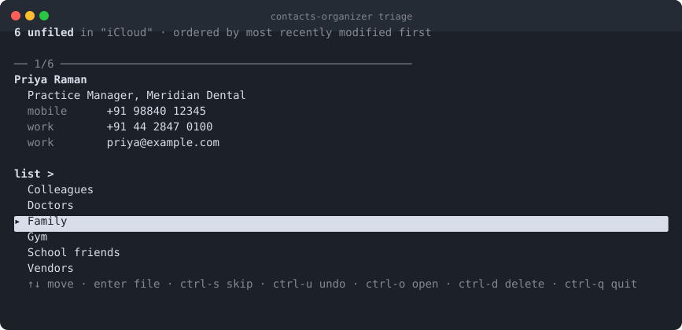

# contacts-organizer


Files unsorted iCloud contacts into lists, from the terminal.



Contacts that belong to no group are treated as an inbox: the tool walks them
one at a time, shows the record, and lists your existing lists. Arrow to the one
you want — or type to filter — and the contact is filed. Re-run whenever new
contacts have piled up.

Only the **iCloud** account is touched. Google, Exchange and "On My Mac"
contacts are ignored — macOS cannot reliably edit their groups.

## Install

```sh
swift build -c release
ln -sf "$PWD/.build/release/contacts-organizer" ~/.local/bin/contacts-organizer
```

`~/.local/bin` is already on PATH. The symlink points at the build output, so a
later `swift build -c release` is the whole update process.

No runtime dependencies.

## Permissions

macOS grants Contacts access to the **terminal app**, not to this binary. The
first run prompts; approve it. If it was denied before, no prompt appears —
switch the terminal on under System Settings → Privacy & Security → Contacts,
or run `tccutil reset AddressBook` to clear the old decision.

A card that carries a **note** cannot be saved by this process at all: since
macOS 13 the note field sits behind an Apple-granted entitlement, and the store
refuses the write with `Cocoa error 134092` while faulting the field it may not
read. On those cards the tool asks Contacts.app to make the change instead, and
says so in the output:

```
  → Bike and Vehicles  (via Contacts.app: this card has a note)
```

That hand-off runs `osascript`, so the terminal also needs Automation
permission: System Settings → Privacy & Security → Automation, with Contacts
switched on under the terminal. Nothing else in the tool uses Contacts.app.

## Usage

```
contacts-organizer            # triage (default)
contacts-organizer wishlist   # decide who gets Diwali wishes, one contact at a time
contacts-organizer stats      # total / filed / unfiled, and per-list counts
contacts-organizer lists      # the lists in your iCloud account
contacts-organizer audit      # contacts that ended up in more than one list
contacts-organizer doctor     # diagnose permissions, account and date matching
contacts-organizer help
```

### Wishlist

`contacts-organizer wishlist` walks every iCloud contact that is in neither
**Wishlist** nor **No Wishlist** and files it into one of them. Both are
ordinary iCloud groups, created on first use, so a decision survives reinstalls
and shows on the phone. A later run asks only about contacts not yet decided.

```
contacts-organizer wishlist           # the undecided contacts
contacts-organizer wishlist --review  # contacts already decided, to change a choice
contacts-organizer wishlist --export  # Wishlist as CSV: name,phone,whatsapp
contacts-organizer wishlist ignore    # tick lists whose contacts are never asked about
```

The picker is the triage picker with two fixed choices; typing filters them
and never creates a list. `ctrl-s` skips, `ctrl-u` undoes, `ctrl-o` opens the
card, `ctrl-d` deletes, `ctrl-q` quits.

Contacts you chatted with most recently on WhatsApp come first, then the rest
by name. The card also shows the last chat, the lists the contact is in, their
WhatsApp name when it differs, and whether you messaged them within three days
of Diwali 2025. All of that is read, read-only, from the local store of
[wacli](https://github.com/openclaw/wacli) (`~/.wacli`, or `WACLI_STORE_DIR`).
Without wacli the walk says so once and uses the triage order. Numbers saved
without a country code are taken as India (`+91`).

`wishlist ignore` opens a checkbox list of your lists (arrows move, `space`
ticks, type to filter, `enter` saves, `esc` cancels). A contact in any ticked
list is hidden from the walk, even if it is also in a list you did not tick;
nothing is written to iCloud, so un-ticking brings it back. The choice is saved
to `~/.config/contacts-organizer/config.toml` (or under `XDG_CONFIG_HOME`) as
group identifiers, so renaming a list keeps it ignored. Review and export are
not affected.

Triage, `stats` and `audit` do not count Wishlist and No Wishlist as lists: a
contact can be in Family and in Wishlist, and still appear in triage if those
two are its only groups. `stats` adds a wishlist section.

`--container <id>` picks a specific account if you have several CardDAV ones;
`stats` prints the identifiers.

### Triage keys

| Key | Action |
|---|---|
| `↑` `↓` | Move the highlight. `ctrl-p` / `ctrl-n` also work. |
| *type* | Filter the lists as you type, ranked exact → prefix → substring, so `work` puts *Work* above *Workshop*. |
| `enter` | File into the highlighted list. If nothing matches what you typed, it offers to create that list. |
| `ctrl-s` | Skip. Nothing is written, so it reappears on the next run. |
| `ctrl-u` | Undo the last assignment and re-show that contact. |
| `ctrl-o` | Open the contact in Contacts.app. |
| `ctrl-d` | Delete the contact. Confirmed separately — this syncs to every device and cannot be undone. |
| `ctrl-q` `esc` | Quit. Each assignment is saved as it happens, so nothing is lost. |

Over a pipe, or on a terminal that cannot do raw mode, it falls back to a
numbered prompt: a number, or text to match, `enter` to skip, `:q` to quit,
`:?` for help. `CONTACTS_ORGANIZER_SIMPLE=1` forces that mode.

## Tests

```sh
swift test
```

92 tests, no fixtures and no terminal required. The parts that decide
behaviour are kept as pure value logic so they can be driven directly:

- **`KeyDecoderTests`** — arrow keys in both normal and application cursor
  mode, escape sequences split across reads, a lone ESC, control keys, and
  partial UTF-8.
- **`PickerModelTests`** — filter ranking, highlight wrap-around, and the
  create-on-no-match path.
- **`RedrawTests`** — replays the emitted escape sequences through a small
  terminal simulator to assert that consecutive frames start on the same
  screen row and that no row is wide enough to wrap. Both of those were real
  bugs: the frame used to walk up the screen on every keystroke.
- **`LinePickerTests`** — drives the fallback picker by pointing stdin at a
  file, including end-of-input.
- **`QueueBuilderTests`** — the definition of "unfiled", and the ordering
  fallback when no modification date matches.
- **`ContactsFallbackTests`** — recognises the note fault at the top level and
  behind a wrapping error, and proves a contact identifier cannot break out of
  the AppleScript string literal it is embedded in.
- **`ModificationDateTests`** — reads a throwaway sqlite store whose newest row
  is still in the `-wal` file, which is where Contacts.app keeps the cards it
  has not checkpointed yet.
- **`PhoneNumberTests`** — the `+91` default, trunk zeros, `00` prefixes and
  JID device suffixes, which decide whether an iCloud card meets its chat.
- **`WhatsAppStoreTests`** — a throwaway wacli store: phone and `@lid` chats,
  the newest message beating a stale chat row, a received message not counting
  as a Diwali wish, and a chat still in the `-wal` file.
- **`IgnoreConfigTests`** — the hand-editable shapes of `wishlist.ignore`,
  comments and `#` inside strings, malformed values, and a write that reads
  back.
- **`WishlistTests`** — undecided and ignored contacts (any ignored list
  hides), chat-recency order and its fallback, review order, the card lines,
  CSV export, the checkbox picker and its frame width.

Nothing here touches the live Contacts store, so the suite runs without the
Contacts permission and cannot modify an address book. The one test that needs
a database builds its own store in a temporary directory.

## Design notes

The screenshot above is generated from the program's real output — the same
`Render.card` and `InteractivePicker.frame` the tool runs — with invented list
and contact names. No real address-book data goes into the repository.

- **One list per contact.** The queue is by definition "contacts in no list", so
  each filed contact lands in exactly one, and the prompt accepts a single
  choice. Use `audit` to catch anything that drifted via Contacts.app or the
  phone.
- **Two pickers, one of them dependency-free by design.** The arrow-key picker
  uses raw mode; the line picker needs no terminal at all and takes over
  automatically when stdin or stdout is not a tty. Key decoding and filtering
  are pure value logic, so both are tested by feeding them bytes rather than
  driving a terminal.
- **The redraw is one write, and every row is clipped to the terminal width.**
  A row that wraps occupies two terminal lines that the cursor arithmetic
  cannot see, which makes each redraw walk up the screen. Rows erase only
  their own tail as they are rewritten rather than blanking the block first,
  and the whole frame is wrapped in a synchronized update (DEC 2026), so
  nothing flickers. `InteractivePicker.frame` returns the frame instead of
  writing it, so a small terminal simulator asserts that consecutive frames
  start on the same row and that no row reaches the terminal width.
- **The terminal is always put back.** Raw mode is restored via `defer`, an
  `atexit` hook, and handlers for SIGTERM/SIGHUP/SIGQUIT, so a killed process
  cannot leave the shell without an echo or a cursor.
- **One state file, and only for the ignore list.** Skipped contacts come
  back next run, by design, and every decision is an iCloud group. The ignore
  list is a preference, not a decision, so it lives in
  `~/.config/contacts-organizer/config.toml`. Its parser reads that one key, so
  the build stays dependency-free.
- **Ordering** is most-recently-modified first. `CNContact` has no public
  modification date, so the dates are read (read-only) from the AddressBook
  Core Data stores. That schema is undocumented; if it stops matching, the tool
  says so and falls back to alphabetical. The read covers the `-wal` file as
  well as the database: sqlite skips it under `immutable=1`, and the rows it
  holds are exactly the newest cards.
- **Notes are not shown, and cannot be written natively.** `CNContactNoteKey`
  has needed an Apple-granted entitlement since macOS 11, so asking for it
  makes the fetch throw, and saving a card that has one fails with
  `Cocoa error 134092` while the store faults the field it may not read. Those
  writes go to Contacts.app through `osascript` instead, and the output marks
  them `via Contacts.app`.
